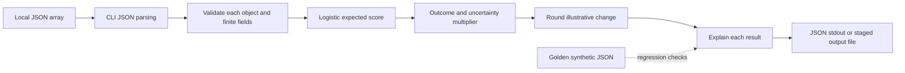

# RankLens — Engineering case study

**Project:** Deterministic toy rating-analysis engine in Python  
**Focus:** Numerical stability, input validation, reproducible evidence, tested CLI behavior

[README](../README.md) · [Algorithm](../ranklens/analyzer.py) · [CLI](../ranklens/cli.py) · [Sample matches](../data/sample_matches.json) · [Golden report](../evidence/sample-report.json) · [CI validation](../evidence/validation.md)

## Problem and scope

Ranked games use complicated rating and matchmaking systems, but illustrating a simple **expected result versus actual result** calculation can make basic algorithmic tradeoffs understandable without relying on any real game's hidden implementation.

RankLens takes synthetic, self-contained JSON records and computes illustrative rating updates from a logistic expected score and an explicitly chosen uncertainty multiplier. It is an **educational mathematical model**, not a recreation of Riot Games' ranking system or a prediction of real game rankings.

## Architecture



| Component | Responsibility |
| --- | --- |
| [`analyzer.expected_score`](../ranklens/analyzer.py) | Validate finite inputs and evaluate the clamped logistic model |
| [`analyzer.analyze_match`](../ranklens/analyzer.py) | Check record schema, outcome and uncertainty; compute a deterministic illustrative rating update |
| [`analyzer.analyze_records`](../ranklens/analyzer.py) | Preserve source order and identify malformed records by 1-based index |
| [`ranklens.cli`](../ranklens/cli.py) | Read input JSON, provide stdout by default, and safely write an optional report |

## Core calculation

The model defines:

```text
E = 1 / (1 + 10^((opponent - own) / 400))
A = 1 (win), 0.5 (draw), 0 (loss)
K = 24
delta = round(K * (0.5 + uncertainty) * (A - E), 2)
illustrative_after = round(own + delta, 2)
```

A win against a higher-rated opponent produces a positive update, a loss against a weaker opponent a negative update, and a draw against an equal-rated opponent no update. Higher uncertainty **amplifies the magnitude** of the update when the other values are fixed. These are properties of the declared formula, not evidence about any competitive game.

## Key engineering decisions

### Saturation with finite input validation

The exponent is clipped to **[−20, 20]** to avoid extreme floating-point powers. The implementation computes `opponent / 400 - own / 400`, rather than subtracting large opposite-sign ratings before division, which can overflow even for two individually finite values.

The parser rejects `NaN`, infinity, booleans, unsupported types and integers too large for finite floating-point representation. It also validates the outcome type before dictionary lookup so unhashable results produce an understandable `ValueError`, not an uncaught `TypeError`. Neither input records nor input ordering are mutated.

### Explainability before predictive claims

Each output includes original rating inputs, expected score, actual score, rounded illustrative change, resulting rating and a short explanation. No hidden features, live rankings or player identities are loaded; `player_id` is an input label only.

### File-safe CLI with backward compatibility

The original CLI wrote JSON directly to stdout. This remains the default. The upgrade adds optional `--output`, blocks output aliases to the source file (including existing hard links), stages a complete JSON document in a same-directory temporary file, and replaces the report only after serialization succeeds. Ordinary malformed input cannot truncate an existing report. Multi-writer coordination and power-loss durability are outside scope.

## Reproducible synthetic evidence

The three committed sample records yield:

| Scenario | Expected score | Illustrated rating change |
| --- | ---: | ---: |
| `demo-01` wins against a higher rating | 0.3869 | +17.66 |
| `demo-02` loses against a lower rating | 0.6661 | −12.79 |
| `demo-03` draws at equal ratings | 0.5000 | 0.00 |

The [versioned JSON report](../evidence/sample-report.json) is compared with the real algorithm and CLI output as parsed JSON during tests. These deterministic values reflect a **three-record fictional fixture**, not statistically validated predictive performance.

## Validation

The expanded unit suite covers score symmetry, monotonicity, win/loss/draw behaviors, uncertainty boundaries, invalid data, numeric extremes, indexed record errors, and golden-report equivalence. CLI subprocess tests exercise default stdout, optional file output, safely replacing a prior report, protecting the source against path and hard-link aliases, malformed JSON and report preservation, argument parsing, UTF-8 BOM, and error exit codes.

GitHub Actions tests Python **3.10–3.12 on Windows and Ubuntu**. See [validation record](../evidence/validation.md) for exact hosted results and source commit.

## Complexity and limitations

For `n` input match records, validation and scoring are **O(n) time** with **O(n) output storage**. Each individual rating update takes O(1) arithmetic operations and fixed extra memory, ignoring the underlying cost of arbitrary-precision integer conversion (extremely large integers are rejected).

- All records are independent; the algorithm does not apply earlier results to later records for the same player.
- Uncertainty is a user-provided multiplier, not a statistically estimated rating confidence interval.
- Results are rounded to two decimal places, which intentionally discards precision.
- The fixed K factor, exponential clamp and expected-score formula are invented educational choices.
- The model does not use real player accounts, actual game rankings, Riot Games APIs or live outcomes.
- Staged report output protects common error cases, not concurrent writers or power-loss failures.

## Interview explanation

> I built RankLens to explore a simple, documented rating-update model using hypothetical match records. It calculates an expected score, compares that with win/draw/loss outcomes, and applies a configurable uncertainty multiplier. The biggest engineering improvements were making the calculation numerically stable for extreme but finite inputs, validating malformed records before arithmetic or dictionary lookup, preserving the existing stdout interface while adding safe JSON-file output, and writing both algorithm-level and real-process CLI regressions against a fixed synthetic JSON report. It's an educational toy model—not a claim about real matchmaking or proprietary rating algorithms.
